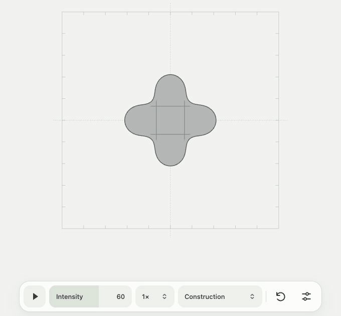
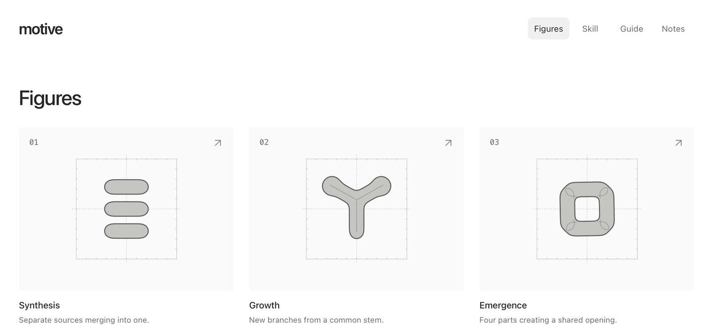

# Motive

**Ideas, set in motion.** Motive is a skill for coding agents. Describe an idea; it asks a few questions about what the motion should express, then makes a looping geometric animation as a standalone HTML file.

[](https://motive-black.vercel.app/figures/emergence/)

[Watch Emergence](https://motive-black.vercel.app/figures/emergence/)

## Install

```sh
npx skills add SohilJ/motive
```

Choose your coding agent when prompted. In Codex, start a new session and try:

```text
$motive Show how independent teams find a shared rhythm.
```

You need Node.js/npm to install the skill and Python 3 to build the animation.

## A file you can keep

One self-contained HTML file per idea. Open it in any browser, even offline. A compact toolbar lets you play or pause, adjust intensity and speed, restart, and switch among Construction, Graphite, Light, and Dark finishes. Construction opens by default.

[Open a standalone animation](https://motive-black.vercel.app/animations/emergence.html)

## Explore the figures

[](https://motive-black.vercel.app/figures/)

[Browse all figures](https://motive-black.vercel.app/figures/) · [Read the guide](https://motive-black.vercel.app/guide/) · [See how Motive was made](https://motive-black.vercel.app/notes/)

## Why I made it

[The gooey effect](https://css-tricks.com/gooey-effect/) is one of the web’s most recognizable visual tricks. I wanted to use it to make original visuals from a prompt, with the idea shaping the motion.

Built by [Sohil Jain](https://sohil.design).
